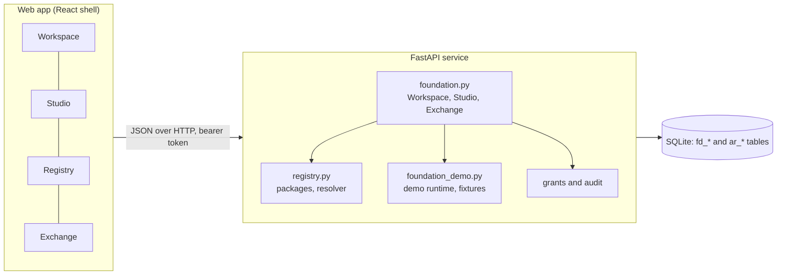
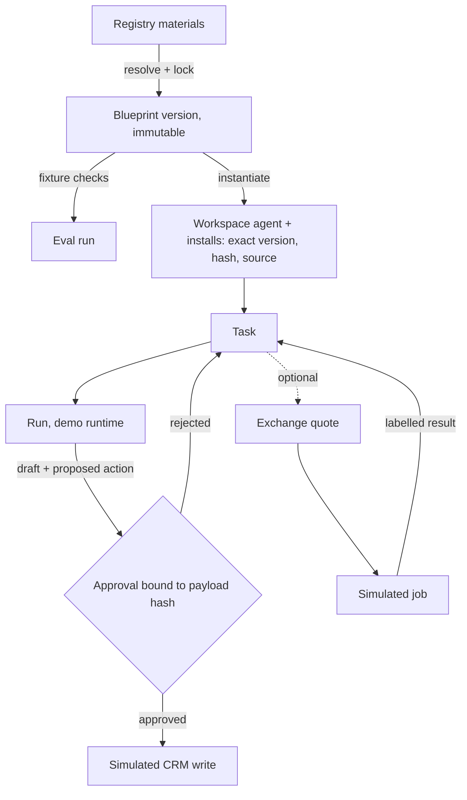

# Papership platform foundation

One local application with four products that share one store, one identity model and one set of rules. Source brief: `docs/blueprints/papership-cursor-foundation-prompt.md`. UI guide: `docs/ui-blueprint/blueprint-3` (identical to the supplied mockup package).

Status words used everywhere: **implemented** (works, tested), **simulated** (works locally with fictional data and no external effect), **preview**, **planned**, **unsupported**, **disabled**. See [CAPABILITY_MATRIX.md](CAPABILITY_MATRIX.md).

## Product definition

| Product | Promise | What exists now |
|---|---|---|
| Workspace | One place for your people, agents, tools and work. | Agents, tasks, runs, approvals, activity, team and tool views, one inspectable workflow with an editable result. |
| Registry | Make expertise installable. | Publish, search, version, depend on, resolve and install Agent Materials. Paid listings are metadata only. |
| Studio | From agent idea to working deployment. | Builder, resolver lock, immutable blueprint versions, fixture checks, create a Workspace agent, export, publish to the local Registry. No deployment. |
| Exchange | Find and buy the capability to get a task done. | A demo catalogue, quotes, budget and policy checks, a simulated job lifecycle linked to a Workspace task. Entirely simulated. |

Workspace is the home. Registry supplies materials, Studio assembles them into a blueprint, Workspace runs the resulting agent, and Exchange can buy a piece of work for a task.

## Architecture



Module boundaries (backend): `registry.py` owns packages and installs of materials; `foundation.py` owns blueprints, agents, tasks, approvals and Exchange; `foundation_demo.py` owns fictional data and the deterministic runtime. The product modules talk through stable IDs and plain functions, never through each other's tables, except the explicit `fd_installs` record that ties an exact package version to an agent.

## Shared foundations

- **Stable IDs**: `bp-`, `bpv-`, `agt-`, `tsk-`, `run-`, `apr-`, `qte-`, `job-`, `act-`; packages are `publisher/name@MAJOR.MINOR.PATCH`.
- **Organisations and roles**: every record carries a tenant. Owner or Founder (`org.admin`, `approval.org.admin`) can decide approvals and set policy. Operators and project leads (`memory.write`) can create and run but cannot decide external actions. Read access is `memory.read`. Agents never decide approvals. Identity is a seeded local demo founder, labelled as such. It is not production authentication.
- **State transitions** are explicit tables in `foundation.py`: task, run, Exchange job. Invalid moves return 409.
- **Approvals** bind to a payload hash. For CRM proposals the payload includes the draft version and its SHA-256, so editing the draft retires the pending approval and raises a new one; a completed task is frozen. Above-threshold Exchange quotes need an approved decision matching the exact quote payload, enforced where the job is created. A decision with a different hash is rejected as stale. A second decision on a decided approval is rejected as a duplicate. The simulated CRM write refuses to run unless the stored approval is `approved` and its payload still matches its hash, so the check holds even if the UI is bypassed.
- **Money** is a currency plus integer minor units, in three separate columns of meaning: estimate (quote), authorised or reserved (job), recorded usage (job, set on validation). Nothing is charged.
- **Secrets**: blueprint configs, task input, exports and published bundles are scanned for credential shapes and rejected. Exports carry references only.
- **Private versus public**: organisation knowledge (`kb_chunks`) stays apart from Registry packages. A blueprint publishes as a private `bundle` containing configuration and a lock, never knowledge.
- **Flags**: `PAPERSHIP_DISABLED_PRODUCTS` (comma list of `workspace`, `registry`, `studio`, `exchange`) makes those routes return 404 and marks the product `disabled` in `/platform/capabilities`.

## Manifest and resolver

A material is a folder of text files plus `agent-package.json`. Fields: slug (`publisher/name`), title (description), kind, description, publisher, version, licence, visibility, pricing or access mode, contents (files), dependencies (`requires`), compatibility (`compatible`), provenance, updated timestamp. Full spec: `docs/agent-registry/PACKAGE_SPEC.md`.

Declared and tested compatibility are separate. `compatible` is what the publisher asserts. `tested_compatibility` is always empty today and the UI says so. Provenance is `registry:local` plus content hash and publisher, labelled an assertion.

Resolver (`foundation.resolve_selection`, wrapping `registry.resolve_dependencies`): highest published version satisfying every constraint, no backtracking and no semantic ranking. It returns the exact lock (name, version, content hash, kind, licence class, source, reason), warnings, `unsupported` conditions (non-open licence, code files), and `errors` (missing dependency, version conflict, dependency cycle). `ok` is false if any error or unsupported condition exists, and saving a blueprint requires `ok`. The lock is stored with the blueprint version.

## Blueprint, agent, task, run



Task: `open`, `in_progress`, `awaiting_approval`, `done`, `cancelled`. Run: `queued`, `running`, `awaiting_approval`, `completed`, `failed`, `cancelled`. A rerun after rejection supersedes the old proposal. The result text is versioned; a save against an old version is a 409.

## Registry purchase versus Exchange procurement

- **Registry purchase** (not live): buy the right to install reusable knowledge, a package, with a licence. Price is metadata. Paid installs are refused by the resolver and the UI says why.
- **Exchange procurement** (simulated): buy a piece of work to be performed for a task, from a provider, with a quote, a budget and an approval. Result arrives on the task with a SIMULATED label.

Open, licensed and hosted: open materials install freely with an SPDX licence; premium and metered materials are listed with prices but not installable; hosted execution (a provider doing work) belongs to Exchange and is simulated.

## Integration contracts

Control is per integration and never implied (shown in Workspace, Team and tools, and in `/platform/capabilities`):

| Integration | Observe | Invoke | Pause | Cancel | Enforce approval |
|---|---|---|---|---|---|
| `papership-demo-runtime` | yes | yes | yes | yes | yes |
| `mock-crm` tool | yes | yes (proposals) | no | no | yes |
| Any third-party agent | no | no | no | no | no |

Adapter contract (planned, not built): `start(task, materials)`, `observe(run)`, `pause(run)`, `cancel(run)`, each declaring which it supports. The `hermes`, `claude-code`, `openai-agents` and `langgraph` adapters are named but refused with a clear message.

## Running it locally

API and web start as described in the repository README and `scripts/`. For a local demo the API needs the local sign-in hook and a signing configuration. Variable names only: `SUPABASE_JWT_SECRET`, `ENGINE_JWT_ISSUER`, `ENGINE_JWT_AUDIENCE`, `ENGINE_TEST_HOOKS`, optional `PAPERSHIP_DISABLED_PRODUCTS`. Values come from your own environment. This repository stores none.

Checks:

```
cd services/api && PYTHONPATH=. .venv/bin/python -m pytest tests -q
cd apps/web && node --test tests/static-scan.test.mjs && npx vite build
```

Demo walkthrough, reset and seed: [DEMO_WALKTHROUGH.md](DEMO_WALKTHROUGH.md).

Sample request and response contracts: [API_CONTRACTS.md](API_CONTRACTS.md).

## Related product families

The foundation leaves room for, and does not build: a hosted runtime marketplace, a verified-publisher programme, Contextbook as a paid knowledge product (here only a small fictional companion material), agent evaluation as a service, and enterprise policy packs. Each would arrive as a new adapter or new material kind behind the contracts above.

## Roadmap

1. **Real runtime adapter**: one external adapter (for example Hermes) implementing observe, invoke, pause, cancel and approval enforcement, replacing the demo runtime for one blueprint.
2. **Tested compatibility**: platform-run checks that populate `tested_compatibility` with evidence.
3. **Registry commerce**: licence acceptance records, then a settlement adapter for paid materials.
4. **Exchange settlement**: provider onboarding, escrow, disputes and refunds behind a settlement adapter.
5. **Production identity and deployment**: real organisations and roles, a deployment backend for Studio, retention and audit export.

## Known limits

The runtime is deterministic and calls no model. The legacy company pages (Today, Work, Inbox and others) remain under Operations in the rail and still show earlier mock data. Demo identity is not authentication. One SQLite connection serialises writes. Eval checks verify structure and approval policy only, never answer quality.
